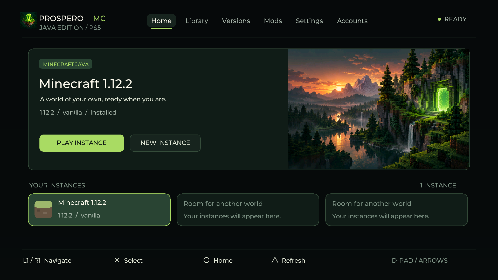

# ProsperoMC

Minecraft Java launcher for homebrew-enabled PS5, rebuilt on [prospero-win](https://github.com/mpereiraesaa/prospero-win). Its native interface takes its appearance from [ProsperoEden](https://github.com/blackbearreloaded/ProsperoEden); the launcher behavior and instance formats follow [PolyMC](https://github.com/PolyMC/PolyMC).

This project is under development and uses Windows x64 Java through Wine.
Vanilla 1.12.2 now loads saved worlds on the tested PS5, with movement and audio.
Performance remains under development. With two preparation workers and
worker-local shader-cache hits, the latest 1440p test peaks at 78-88 FPS at
8 chunks, falling to 44-54 when turning. At 16 chunks it gives 19-30 FPS,
mostly 24; returning to 8 averages about 53. These are manual observations
rather than a fixed benchmark. Console logs verify both workers on cores
10/12. An opt-in batch timing build measures the remaining preparation and
retirement waits while retaining these optimizations.
Stable 60 FPS at 16 chunks is unverified.
FreeSync off resolved the reported bright-area flicker. With the monitor set to
120 Hz, the user reaches about 120 FPS looking at the sky. Vanilla 1.12.2 limits
its main menu to 30 FPS. Current game graphics choices are preserved.
Other versions, mod loaders and online features require separate
console checks. It is an independent launcher, not an embedded Qt build of PolyMC.



**Home-screen music — “hollow. (mastered)” by [steveologic](https://github.com/steveologic).**
Huge thanks to steveologic for the soundtrack! Follow his work on
[Instagram](https://www.instagram.com/steveoology/). An 87-second loop plays
when ProsperoMC is highlighted in the PS5 home menu, through `sce_sys/snd0.at9`;
it does not play inside the launcher. Refresh the loader's cached presentation
assets after updating if the previous selection music remains.

The main flow is to choose a release or snapshot in Versions and download it.
Installation selects the Java major required by that version, reuses a valid
installed Windows x64 runtime, or downloads a verified runtime when missing.
Settings lists detected runtimes and offers Java downloads. Minecraft 1.12.2
is the initial test case, not the application's fixed or main version.
Settings selects 1280×720, 1920×1080, 2560×1440 (2K/1440p) or
3840×2160 (4K). Changing the resolution saves it immediately for the next
launch; memory changes still use Save Settings. These are game-rendering
resolutions; the HDMI output mode depends on the console/display. Higher
resolution can reduce performance.
Game windows have edge resizing disabled on PS5.

To add a modpack, copy a PolyMC/MultiMC ZIP or Modrinth `.mrpack` into
`/data/ProsperoMC/imports` over FTP. In Library or Mods, press Square, choose
the pack, and press X. Select the new instance to install its game and loader
dependencies. Each pack keeps its own mods, configuration and worlds. Fabric,
Quilt and Forge 1.12.2 manifests are supported; modern Forge/NeoForge and
CurseForge manifests are still unsupported. Modrinth files are verified against
both SHA1 and SHA512, and client overrides take precedence over shared overrides.

L1/R1 cycle the hotbar, and USB mouse-wheel ticks are forwarded to the game.
The display profile requests 120 Hz with the upstream SDK's 60 Hz fallback;
actual refresh depends on the console/display accepting the mode. Minecraft's
own FPS and VSync settings are preserved. The launcher has focus transitions,
animated progress feedback, held-D-pad scrolling and quiet navigation sounds.
In the launcher, the D-pad or left stick navigates, X selects, and L1/R1 switch
tabs. The right stick moves the pointer and R2 clicks. USB mouse movement,
left-click, right-click (back), and wheel scrolling are supported. Lists select
on click; use the Play or Download button to start an operation.

Recent upstream Wine changes are reviewed selectively; see the
[October 9 upstream review](docs/upstream-review-2026-10-09.md). New Minecraft
releases include a Vulkan renderer, but modern Minecraft/Java/LWJGL and the
packaged Wine/RADV path still need console validation. The working 1.12.2
instance uses OpenGL on the PS5 GPU.

## Build and use

From Windows CMD, run `ProsperoMC.cmd build-send` to build and update the
existing PS5 installation at `192.168.1.111:2121`. Close the app and start its
FTP server first. Use `build` or `send` separately, or double-click for a menu.
Updates preserve console worlds, settings, mods and Java. See
[build and deployment details](docs/build-and-deploy.md).

Build the Java launcher with `./scripts/build-launcher.ps1` on Windows or `bash scripts/build-launcher.sh` on Linux with a JDK. Build the native title with `./scripts/build-ps5.ps1` or `bash scripts/build-ps5.sh`. The PS5 build uses the pinned public SDK and native foundation.

The identical backend JAR runs on the PC and through Wine on PS5:

```powershell
java -jar artifacts/launcher/prosperomc-launcher.jar --root game-data/prosperomc --request request.properties
```

Requests use UTF-8 `key=value` lines. See the launcher documentation and [architecture](docs/architecture.md). All writable Java, Minecraft instances, mods and downloads live together under `/data/ProsperoMC`; the loader package is `/data/homebrew/PPSA99888`.

Only Minecraft instances and internally generated Java profiles are offered. General PC-game importing and emulator functionality are absent. The previous JavaCraft probe is preserved locally in `artifacts/previous-javacraft-source.zip` and `artifacts/previous-project-tooling.zip`.

See [feature audit](docs/feature-audit.md), [console checks](docs/console-tests.md), [provenance](docs/provenance.md), and [acceptance gates](GATES.md) for implemented features, limitations and verification evidence.

## Licensing

Repository-owned application code is GPL-3.0-or-later; vendored prospero-win retains LGPL-2.1-or-later and component licenses. Java and fonts retain their own notices. Local game files, account state, downloaded runtime binaries and build outputs are ignored by Git. See LICENSES.md and the vendored runtime notices.
