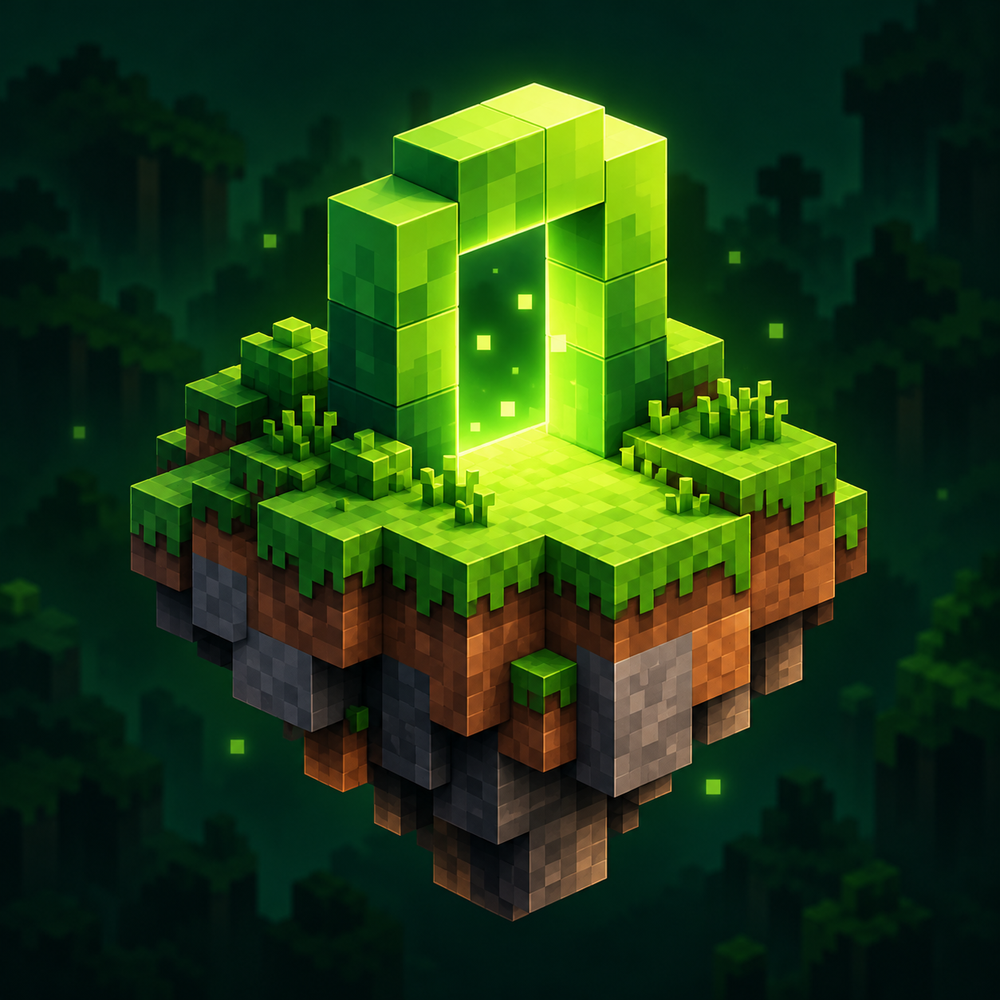
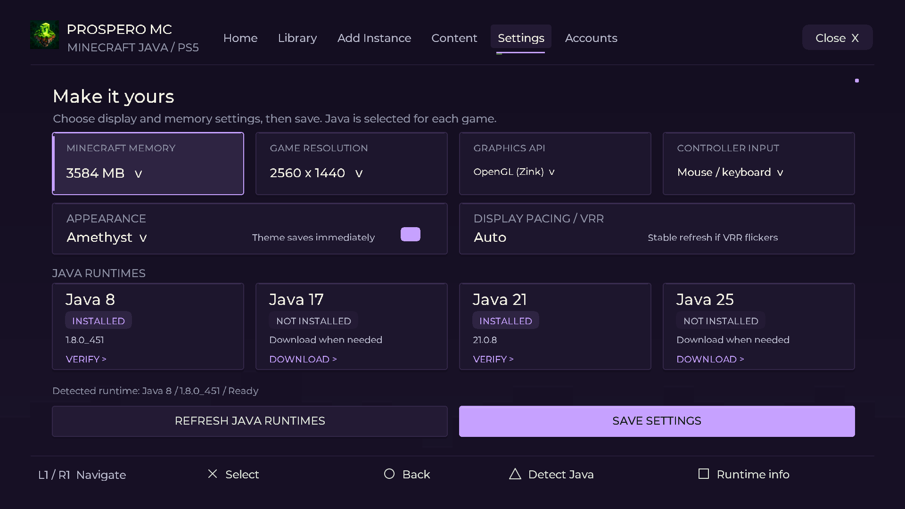

  

<h1 align="center">ProsperoMC</h1>

<strong>Your worlds, your mods, your PS5.</strong> Minecraft: Java Edition launcher for homebrew-enabled PlayStation 5.

  
  
  

ProsperoMC brings vanilla Minecraft and compatible modpacks to PS5, with a native launcher designed for your controller. Browse packs, manage your instances, choose your graphics backend and jump back into your worlds.

Built on [prospero-win](https://github.com/mpereiraesaa/prospero-win), with Minecraft's Windows Java runtime running through Wine.

**A huge thanks to [steveologic](https://github.com/steveologic) for the original soundtrack, “hollow. (mastered),” heard on the PS5 home screen.** [Follow his work](https://www.instagram.com/steveoology/).

> **Early release — experimental alpha.** Compatibility varies between Minecraft versions and modpacks. Back up worlds you care about before updating.

*Preview rendered by the launcher's native UI.*

## Features

- **Vanilla and modded Minecraft.** Choose releases or snapshots, with Fabric, Quilt and legacy Forge 1.12.2 support.
- **Modpacks and content.** Browse Modrinth packs, mods, resource packs and shaders. Import `.mrpack` and PolyMC/MultiMC ZIPs. CurseForge integration uses your own API key.
- **Your own library.** Separate instances, pack artwork, rename, clone and export. Worlds and settings stay with their instance.
- **Two graphics choices.** OpenGL through Zink, or Minecraft's Vulkan renderer on supported versions. Use Zink for compatible shader packs.
- **Controller or keyboard.** DualSense launcher navigation, keyboard/mouse emulation and native input for compatible controller mods. USB mouse and keyboard are supported.
- **Make it yours.** Theme colors, resolution, memory and display-pacing settings, with automatic Java selection and downloads.
- **Account options.** Microsoft device sign-in from your phone or computer, plus local offline single-player mode. See [account setup](docs/microsoft-sign-in.md).

## What you need

- A homebrew-enabled PS5 and a loader that supports folder-based applications, such as [ShadowMountPlus](https://github.com/drakmor/ShadowMountPlus).
- FTP access from a computer on the same network, for installation and updates.
- A copy of Minecraft: Java Edition. Online authentication requires a Microsoft account that owns the game.
- Internet access to download Minecraft, Java and packs.

## Getting started

1. Download and extract the early-release package from [Releases](https://github.com/Ayoubec/ProsperoMC/releases).
2. Copy `PPSA99888` to `/data/homebrew/PPSA99888`, and the bundled `prosperomc` data folder to `/data/ProsperoMC`, over FTP.
3. Refresh your loader's app list and open **ProsperoMC**.
4. Open **Accounts** to choose your account mode, then **Add Instance** to install Minecraft or a modpack.
5. Choose **OpenGL (Zink)** or **Vulkan** in **Settings**, save, and select your instance to play.

Close Minecraft and the launcher before updating. Keep your existing `/data/ProsperoMC` worlds, instances and private account files; follow the release's update instructions instead of replacing that folder wholesale.

For a manual build or deployment, see [Build and deploy](docs/build-and-deploy.md). CurseForge setup is covered [here](docs/curseforge.md).

## Recommended setup

**Use Vulkan for the best experience on supported Minecraft versions.** Select **Vulkan** as Minecraft's renderer, quit back to the launcher, then choose **Settings → Graphics API → Vulkan**, save and launch again. For shader packs or versions without built-in Vulkan, use **OpenGL (Zink)**.

**For DualSense gameplay, we recommend [Controlify](https://modrinth.com/mod/controlify).** Install a version compatible with your Minecraft instance and select native controller input in the launcher. You can also play with a **USB mouse and keyboard**.

## Controls

| Input | Launcher action |
| --- | --- |
| D-pad / left stick | Move between items |
| Cross | Select / confirm |
| Circle | Back |
| L1 / R1 | Switch tabs |
| Right stick / R2 | Move pointer / click |

The footer shows the actions available on each screen. In-game controls depend on your selected input mode and controller mod.

## Known limitations

- Modpack compatibility and performance are still being improved. Chunk loading can cause pauses, particularly in heavier Zink packs.
- Shader packs currently use **OpenGL (Zink)**; shader support in Minecraft's Vulkan backend is unavailable in this build.
- Modern Forge and NeoForge installers are not supported yet.
- Multiplayer compatibility varies by game version, server and account setup. Firmware and loader compatibility need broader community testing.

See the [compatibility notes](docs/feature-audit.md) for more information.

## Help improve it

[Report an issue](https://github.com/Ayoubec/ProsperoMC/issues) with your firmware, loader, Minecraft/modpack version, graphics backend and steps to reproduce it. Remove account details and tokens from logs before sharing them.

Code, testing and compatibility reports are welcome. Start with [Contributing](CONTRIBUTING.md).

## Credits and license

Thanks to [prospero-win](https://github.com/mpereiraesaa/prospero-win) and the [PS5 Payload SDK](https://github.com/ps5-payload-dev/sdk) contributors for the runtime and tooling, and [PolyMC](https://github.com/PolyMC/PolyMC) for launcher and instance-format references.

ProsperoMC application code is **GPL-3.0-or-later**. Dependencies and music retain their own licenses; see [Licensing](LICENSES.md) and [Third-party notices](THIRD_PARTY_NOTICES.md). Minecraft game files are downloaded separately and are not included in the release.

This is an independent homebrew project, unaffiliated with Mojang, Microsoft or Sony.
